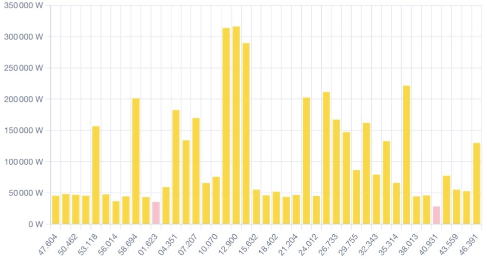

# Zielgruppe

Dieser Artikel richtet sich an Fachleute in Industrieunternehmen, die formell oder informell für den Einkauf und die Nutzung von Energie verantwortlich sind.

Diese Verantwortung kann je nach Unternehmen bei ganz unterschiedlichen Rollen liegen.

Neu hinzukommende Aspekte dieser Verantwortung können manche dieser Fachleute vor große Herausforderungen stellen oder sogar überfordern.

An sie richtet sich dieser Artikel ganz besonders.

# Ziel dieses Artikels

Zeigen, warum Lastspitzen gemanagt werden sollten, welche Arten von Lastspitzen es gibt und welche typischen Wege es gibt, sie zu managen.

# Quellen

Dieser Artikel stützt sich lose auf das _Magnum Opus_ des Autors &mdash; das Handbuch &mdash; __How to Ask and Answer Questions Related to Renewable Energy In Industrial Contexts__.

Die Daten und Diagramme stammen aus einer realen Fabrik.

Der Autor hat bereits eine Reihe von Lösungen für das Lastspitzenmanagement im industriellen Umfeld umgesetzt.

# Keine Verbindung

Für keine der in diesem Artikel genannten Lösungen wird eine Empfehlung ausgesprochen oder die Eignung für einen bestimmten Zweck zugesichert.

Alle Beispiele dienen ausschließlich der Veranschaulichung und wurden nach ihrem fachlichen Wert ausgewählt.

# Management oder Kappung

_Peak Shaving_ (Lastspitzenkappung) ist eine umgangssprachliche Bezeichnung für einen Aspekt des _Lastspitzenmanagements_: die _Reduzierung_ von Lastspitzen.

# Lastspitzenmanagement

Die Tätigkeit, Lastspitzen zu managen, indem entweder die Industrieanlagen gesteuert werden, die sie verursachen, oder eine unterstützende Anlage, die sie senkt, oder beides.

# Gründe für Lastspitzenmanagement

Lastspitzen können eine Reihe von Grenzwerten überschreiten.

Manche dieser Grenzwerte können durch den oder die Energieverträge vorgegeben sein. Manche durch Sicherungen oder Leistungsschalter. Und manche können, einzeln oder als Kombination der zuvor genannten, den Betrieb von Anlagen einschränken und damit &mdash; die industriellen Prozesse.

# Grenzwerte

# Grenzwerte durch die Energieinfrastruktur

Eine der wichtigsten Quellen für Grenzwerte im industriellen Umfeld sind die _Netzbetreiber_.

Diese Grenzwerte gibt es typischerweise in zwei Arten &mdash;

* Spitzenleistungsgrenze (W) und
* Energiegrenze pro Zeitraum (Wh).

## Leistung vs. Energie

Diese einfachen Begriffe werden erstaunlich selten richtig verstanden.

Hier eine kurze Erklärung.

Leistung (W, Watt) ist die Rate, mit der in einem bestimmten Moment Strom verbraucht oder erzeugt wird. Leistung lässt sich mit der Geschwindigkeit eines Autos vergleichen.

Energie (Wh, Wattstunden) ist die Gesamtmenge an Strom, die über einen Zeitraum verbraucht wird. Energie lässt sich mit der Strecke vergleichen, die ein Auto zurücklegt.

Anders betrachtet ist _Leistung_ eine Momentaufnahme und _Energie_ die Summe über die Zeit.

Und noch einmal anders betrachtet ist Leistung die Menge Wasser, die gerade durch ein Rohr fließt, und Energie die Gesamtmenge an Wasser, die in einem bestimmten Zeitraum durch das Rohr geflossen ist.

## Spitzenleistungsgrenze (W)

Die Spitzenleistungsgrenze (W) begrenzt Bezug und/oder Einspeisung oberhalb des Grenzwerts, auch wenn er nur für kurze Zeit überschritten wird.

Ein Überschreiten der Spitzenleistungsgrenze (W) kann dazu führen, dass Leistungsschalter auslösen, um das Netz zu schützen.

Der Industriestandort kann dadurch die Versorgung aus dem Netz verlieren.

Zusätzlich können Vertragsstrafen anfallen.

## Energiegrenze pro Zeitraum (Wh) 

Die Energiegrenze pro Zeitraum begrenzt Bezug oder Einspeisung nicht als Spitze, sondern bezogen auf die Zeit.

Für unsere Fabrik wird die Energiegrenze pro Zeitraum folgendermaßen berechnet. Die Fabrik hat eine Energiegrenze pro Zeitraum von 398 000 Wh. Sie darf in keinem 15-Minuten-Zeitraum 1/4 dieses Grenzwerts, also 99 500 Wh, überschreiten.

## Netzgrenzwerte als Verhandlungsmasse

Die Netzgrenzwerte können in komplexen Verhandlungen zur Verhandlungsmasse werden.

Unsere Beispielfabrik könnte mit einer benachbarten Fabrik einen Energie-Hub bilden, um überschüssige elektrische Energie auszutauschen.

Der Netzbetreiber ist bereit, das zuzulassen, wird dann aber die Grenzwerte beider Unternehmen senken. Die gesenkten Grenzwerte lägen unter dem Mindestbedarf, den die Beispielfabrik für ihren Betrieb braucht. Damit ist der Hub nicht umsetzbar.

# Grenzwerte durch Sicherungen und Leistungsschalter

Sicherungen und Leistungsschalter sind ein weiterer Grund, Lastspitzen zu managen.

In einem anderen Beispiel verfügt ein Standort über große Wassererhitzer, die mehr Energie verbrauchen, als die Sicherungen/Leistungsschalter verkraften.

# Priorisierung

Die Grenzwerte für Lastspitzen können dazu führen, dass Anlagen, die für die industriellen Prozesse gebraucht werden, nicht betrieben werden können.

Das Lastspitzenmanagement kann in diesem Fall eine Neugestaltung des industriellen Prozesses erfordern.

# Grenzwerte im größeren Zusammenhang

Nicht jede Notwendigkeit schlägt sich in einem Grenzwert nieder.

Eine gute Energiemanagement-Strategie blickt über die Gegenwart hinaus in eine unvorhersehbare Zukunft.

„Niemand kann die Zukunft vorhersagen“, sagt Uto Baader, der 82-jährige deutsche Bankier, zu Beginn seiner Eröffnungsreden.

Navigieren kann man durch sie aber sehr wohl.

„Verändere dich, bevor du es musst“, sagte gern 

# Lastspitzen

## Arten von Lastspitzen

Im industriellen Umfeld gibt es zwei Hauptarten von Lastspitzen.

## Schnelle Lastspitzen

Schnelle Lastspitzen werden von Anlagen wie Kranen und Schweißgeräten verursacht.

Ein Kran kann 4 x 5 kW Elektromotoren zum Verfahren und 2 x 50 kW Elektromotoren zum Heben haben und gleichzeitig verfahren und heben, also auf Knopfdruck 120 kW abrufen.

## Langsame Lastspitzen

Langsame Lastspitzen entstehen durch das Zuschalten von Anlagen, die über längere Zeit in Betrieb bleiben. Wie im Beispiel oben, in dem große Wassererhitzer mehrere Stunden lang laufen müssen.

# Lastspitzenmanagement

In diesem Abschnitt sehen wir uns an, wie Lastspitzen gemanagt werden. Der Ansatz hängt von den Gründen und von den übergeordneten Zielen ab.

## Strategien

Lastspitzenmanagement erfordert eine Strategie.

Die einfachste und verbreitetste Strategie ist die Abregelung der Photovoltaik-Leistung. Wenn die Sonne scheint und alle Photovoltaikanlagen in einem Gebiet einspeisen, kann der Netzbetreiber die Einspeisung ins Netz begrenzen. Strom ist aber nicht wie Wasser, man kann nicht einfach ein Ventil zudrehen. Man muss die Wechselrichter anweisen, weniger Strom zu erzeugen.

Je nach Ursache der Lastspitzen und den Gründen, sie zu managen, lassen sich unterschiedliche Strategien entwickeln.

## Umsetzung

Die Umsetzung der Strategie erfordert den Entwurf einer Logik, eine Energiemanagement-Software und eine Steuerungshardware.

## Logik

Die Logik kann einfach oder komplex sein.

## Regelungstechnik

Eine wichtige Tatsache bei der Steuerung von Industrieanlagen: Sie haben nicht selten eine Reaktionszeit und ein Reaktionsmuster.

Nicht selten muss beides berücksichtigt werden.

So sollte auf einen Steuerbefehl beispielsweise eine Wartezeit folgen, die dem System Gelegenheit gibt, den gewünschten Zustand zu erreichen. Andernfalls kann es zum Übersteuern kommen, also dazu, dass das System über den gewünschten Zustand hinaus gefahren wird.

Nach Erhalt eines Steuerbefehls erreicht das System den gewünschten Zustand womöglich, womöglich aber auch nicht. Das kann mehrere Gründe haben, etwa dass ihm die Ressourcen dafür fehlen oder dass es ein Eigenleben hat und deshalb zusätzlichen Regeln folgt.

All diese Faktoren sind bei der Entwicklung einer Strategie für das Lastspitzenmanagement zu berücksichtigen.

## Eine Industriesteuerung

In allen Fällen gehört zum Lastspitzenmanagement eine Industriesteuerung, die mit den am Lastspitzenmanagement beteiligten Anlagen kommunizieren kann.

## Energiemanagement-Software

Auf der Steuerung läuft eine Energiemanagement-Software, die die Strategie umsetzt, indem sie Regeln anwendet und dazu Steuerbefehle an die am Lastspitzenmanagement beteiligten Anlagen sendet.

Zuvor führt die Steuerung Messungen durch, die die Grundlage für ihre Entscheidungen und für die von ihr gesendeten Befehle bilden.

## Notsteuerung

Wenn man Lastspitzen beispielsweise mithilfe von Batteriespeichern managt, braucht man eine Notsteuerung für die Last, die die Lastspitzen verursacht.

Der Grund dafür ist, dass sich die Batteriespeicher entladen können, bevor das Lastspitzenintervall endet, was zu Schäden durch die nicht mehr abgefangene Spitzenlast führen kann.

Um solche Schäden zu verhindern, muss die Steuerung die lastverursachenden Anlagen abschalten können. Das kann möglich sein oder auch nicht; im zweiten Fall muss die Steuerung einen Alarm auslösen können.

Lastverursachende Anlagen lassen sich per direkter Ansteuerung abschalten, sofern die Anlage dies unterstützt. Oder mit einem einfachen Relais, das schlicht die Stromversorgung der Anlage unterbricht. Ein brutaler, in manchen Fällen aber wirksamer Weg.

## Managen oder nicht managen

Wenn Lastspitzen keinen der für den Industriestandort geltenden Grenzwerte überschreiten, müssen sie nicht gemanagt werden.

Bezogen auf Spitzenleistungsgrenze vs. Grenze über die Zeit.

## Management schneller Lastspitzen. Kinetische Lösungen

Teraloop.

# Fragen?

Wenn Sie Fragen haben, wenden Sie sich gerne an die Autoren dieses Artikels.

# Lernen Sie den Autor kennen

Auf der SPS in Nürnberg im Oktober.

# Urheberrecht

Alle Rechte liegen bei den Autoren.

Der Artikel darf ganz oder in Teilen vervielfältigt werden, sofern der Originaltitel und die Autoren genannt werden und ein Link auf diese Seite angegeben wird.