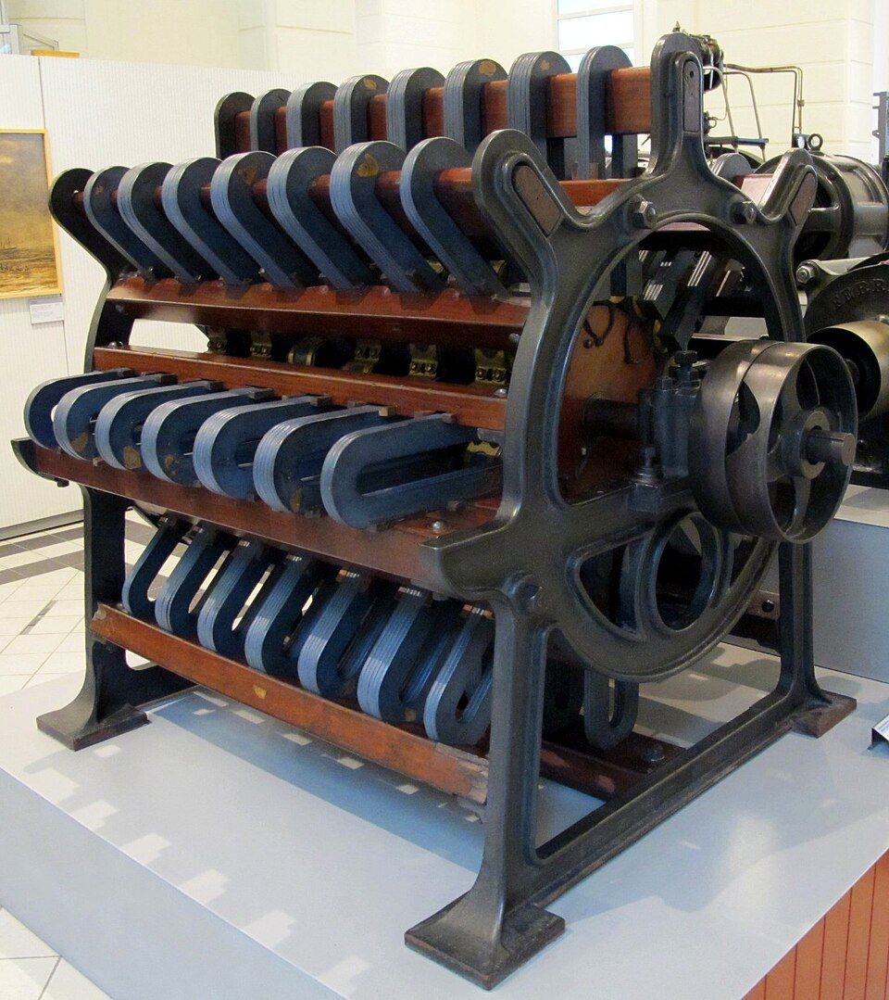
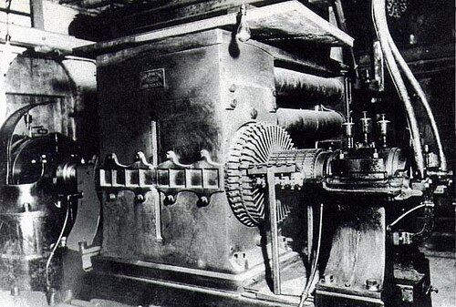

# Zielgruppe

Dieser Artikel richtet sich an Fachleute, die in industriellen Kontexten für den Einkauf und die Nutzung von Energie verantwortlich sind.

# Lügen-für-Kinder

Damit der Artikel kurz und interessant bleibt, werden einige komplexe Themen vereinfacht.

Die ausführliche Geschichte steht in meinem _Magnum Opus_ — dem Handbuch — Wie man Fragen zu erneuerbarer Energie im industriellen Kontext stellt und beantwortet.

# Das Netz?

Das Stromnetz.

# Warum über das Netz sprechen?

Das Netz ist ein wesentlicher Faktor im Energiebereich und wird in Zukunft eine wichtige Rolle spielen. Eine Rolle, die alle im industriellen Kontext bereits betrifft und weiter betreffen wird. Sein Wesen und die bevorstehenden Veränderungen sollten daher verstanden und berücksichtigt werden.

# Was ist das Netz?

Das Netz ist die Infrastruktur, die Energiequellen vor dem Zähler (In-Front-of-the-Meter, FTM) mit dem Verbrauch hinter dem Zähler (Behind-the-Meter, BTM) verbindet. Über kurze, lange und sehr lange Strecken.

# Eine kurze Geschichte des Netzes

Das Netz wurde nicht entworfen. Es ist gewachsen, Schritt für Schritt, und jeder Schritt hat etwas hinterlassen, mit dem wir bis heute leben.

## Am Anfang: kein Netz

Es gab kein Netz. Energie wurde dort erzeugt, wo sie genutzt wurde.

Eine Fabrik hatte ihre eigene Dampfmaschine. Transmissionswellen und Lederriemen übertrugen die Kraft auf die Maschinen. Licht kam von Gas, Öl und Kerzen.

## 1860er-Jahre: Ein Generator, ein Verbraucher

Floris Nollet, ein belgischer Professor, konstruierte 1849 einen dampfgetriebenen Generator. Nach seinem Tod entwickelte das Unternehmen L'Alliance ihn weiter.

1863 begann eine Alliance-Maschine, den Leuchtturm am Cap de la Hève bei Le Havre zu beleuchten. Sie speiste eine einzige Bogenlampe.

Ein Generator, ein Verbraucher. Buchstäblich.

Die Maschine erzeugte Wechselstrom, Frequenz gab es also bereits. Aber das interessierte niemanden. Wurde die Maschine langsamer, wurde die Lampe etwas dunkler, und sonst war niemand betroffen.

Frequenz: kein Problem.

## 1882: Ein Kraftwerk, viele Verbraucher

1882 eröffnete Thomas Edison die Pearl Street Station in New York. Dampfmaschinen trieben Dynamos an, und Kabel führten vom Kraftwerk direkt zu den Lampen der Kunden, im Umkreis von etwa einer Meile.

Ein Netz in unserem Sinne gab es nicht. Es gab ein Kabel zwischen dem Typen mit der Turbine und dem Typen mit der Glühbirne. Der Besitzer des Kraftwerks war das Netz.

Pearl Street arbeitete mit Gleichstrom bei niedriger Spannung. Deshalb war die Reichweite so gering.

Gleichstrom hat keine Frequenz. Frequenz: kein Problem.

## Leistung und Energie: kW und kWh

## 1891: Der Wechselstrom bringt die Frequenz

Der Wechselstrom gewann den „Stromkrieg“. Mit Transformatoren ließ sich die Spannung für lange Strecken hochsetzen und für den Verbraucher wieder absenken.

1891 übertrug eine Drehstromleitung Strom über 175 km von Lauffen am Neckar zur elektrotechnischen Ausstellung in Frankfurt am Main, mit 40 Hz.

Mit dem Wechselstrom kommt die Frequenz. In einem kleinen System mit einem Generator ist die Frequenz einfach die Geschwindigkeit, mit der sich der Generator dreht.

Jede Stadt wählte ihre eigene. In Europa war alles von 25 Hz bis 60 Hz im Einsatz, bevor man sich langsam auf 50 Hz einigte.

Immer noch kein Problem. Jedes Kraftwerk speiste seine eigenen Lampen mit seiner eigenen Frequenz, und Lampen merken davon kaum etwas.

## Wechselstrom vs. Gleichstrom: Warum der Transformator gewann

## 1890er-Jahre: Die Frequenz wird zum Problem

Zwei Dinge änderten sich.

Erstens: Elektromotoren. Ein Wechselstrommotor dreht sich mit einer Drehzahl, die von der Frequenz vorgegeben wird. Sinkt die Frequenz, werden die Maschinen in der Fabrik mit ihr langsamer. Jetzt ist die Frequenz für den Verbraucher wichtig.

Zweitens: Kraftwerke werden miteinander verbunden. Zwei Generatoren an denselben Leitungen müssen im Gleichschritt laufen, mit exakt derselben Frequenz.

Ab hier ist die Frequenz ein Problem, und jemand muss sie stabil halten.

## Last bremst den Generator

Schaltet jemand einen großen Motor ein, zieht die Last an der Welle. Der Generator wird langsamer, und die Frequenz sinkt.

Weniger Last: Der Generator wird schneller, und die Frequenz steigt.

Die Frequenz ist also ein Signal. Sie sagt allen im selben Moment, ob zu wenig oder zu viel erzeugt wird.

## Der Drehzahlregler und der Heizer

Zwei Dinge halten die Drehzahl stabil.

Das Erste ist der Drehzahlregler an der Maschine. Der klassische Fliehkraftregler hat zwei schwere Metallkugeln, die sich auf einer Welle drehen. Wird die Maschine langsamer, fallen die Kugeln nach innen, und das öffnet das Dampfventil.

Das Zweite ist der Heizer. Er beobachtet das Manometer des Kessels. Verbraucht die Maschine mehr Dampf, sinkt der Druck, und er feuert stärker nach.

Reicht der Dampf nicht, ist das Ventil weit offen, und die Maschine kann trotzdem nicht mehr leisten. Die Frequenz fällt weiter. Einige Kunden müssen abgeschaltet werden (Lastabwurf), oder das System bricht zusammen: ein Blackout.

## Was ist Momentanreserve?

Momentanreserve ist die Trägheit einer schweren rotierenden Masse, also ihr Widerstand gegen jede Änderung ihrer Drehzahl. Denken Sie an ein schweres Schwungrad: Es lässt sich nur schwer abbremsen.

Ein großer, schnell drehender Rotor speichert viel kinetische Energie. Springt die Last, wird zuerst diese Energie entnommen, bevor die Drehzahl merklich sinkt. Die Momentanreserve verschafft dem Drehzahlregler und dem Heizer Zeit.

Momentanreserve ist nicht die Geschwindigkeit, mit der ein Kraftwerk seine Leistung ändern kann. Ein Kernkraftwerk ändert seine Leistung nur langsam, aber seine riesige Turbine liefert reichlich Momentanreserve. Wie schnell ein Kraftwerk seine Leistung ändert, nennt man Rampenrate oder Flexibilität.

Mit einem kleinen Generator gibt es wenig Momentanreserve, und die Frequenz schwankt stark. Solange nur Lampen angeschlossen waren, störte das niemanden. Mit Motoren und einem zweiten Generator wird es wichtig.

## Zwei Generatoren

Schließt man einen zweiten Generator an dieselben Leitungen an, rasten die beiden ineinander ein. Sie drehen sich mit exakt derselben Frequenz.

Steigt die Last, sehen beide denselben Frequenzabfall. Jeder erhöht seine Leistung im Verhältnis zu seiner Größe, weil ihre Regler dieselbe Statik („Droop“) verwenden. Der große übernimmt den großen Anteil.

Ihre rotierenden Massen addieren sich. Mehr Momentanreserve, stabilere Frequenz.

## Unabhängig, aber gekoppelt

Die Generatoren können unterschiedlichen Eigentümern gehören. Wirtschaftlich sind sie unabhängig, elektrisch aber gekoppelt.

Fällt einer aus, müssen die anderen seine Last sofort übernehmen. Können sie das nicht, werden sie langsamer, der Netzschutz schaltet weitere ab, und der Ausfall beschleunigt sich: ein Kaskadenausfall. So entstehen viele reale Blackouts.

Deshalb halten Netze freie Kapazität am Laufen, die sogenannte rotierende Reserve.

## Netzschutz: Leistungsschalter und Lichtbögen

## Schwarzstart: Ein totes Netz wieder hochfahren

## 1920er-Jahre: Jemand kümmert sich um das Kabel

Sobald sich mehrere Kraftwerke die Leitungen teilen, muss sich jemand um das Kabel kümmern. Bildlich gesprochen lässt der Typ mit der Turbine das Kabel los und konzentriert sich auf die Turbine.

In Großbritannien wurde 1926 das Central Electricity Board gegründet, um ein landesweites Netz aufzubauen. In Deutschland baute RWE um 1930 eine Nord-Süd-Leitung, die rheinische Kohle mit alpiner Wasserkraft verband.

Die erste Pflicht derer, die sich um das Kabel kümmerten, war der Ausgleich: die Erzeugung gleich dem Verbrauch halten, damit die Frequenz auf ihrem Nennwert bleibt.

Sie beobachteten Frequenzmesser. Ein verbreiteter früher Typ war der Zungenfrequenzmesser: eine Reihe kleiner Stahlzungen, jede auf eine etwas andere Frequenz abgestimmt. Die Zunge, die am stärksten schwingt, zeigt die aktuelle Frequenz an.

Sank die Frequenz, riefen sie bei den Kraftwerken an: „zehn Megawatt mehr“, „noch einen Kessel anfahren“. Das ist der Ursprung der Lastverteilung (Dispatching).

## 1950er-Jahre: Netze verbinden sich mit Netzen

Als Nächstes verbinden sich Netze mit Netzen. Städte, dann Regionen, dann Länder.

1951 gründeten die westeuropäischen Netzbetreiber zur Koordination die UCPTE. 1958 wurden die Netze Deutschlands, Frankreichs und der Schweiz in Laufenburg zusammengeschaltet, dem „Stern von Laufenburg“.

Heute läuft das kontinentaleuropäische Netz von Portugal bis in die Türkei mit einheitlich 50 Hz. Die Ukraine und Moldau kamen 2022 hinzu, die baltischen Staaten im Februar 2025. Tausende Generatoren drehen sich gemeinsam, und ihre gemeinsame Momentanreserve macht die Frequenz sehr stabil.

Größe bringt neue Probleme. Eine Störung erreicht nicht alle gleichzeitig: Die Frequenzänderung breitet sich als Welle über das Netz aus, von Rotor zu Rotor, mit mehreren hundert Kilometern pro Sekunde. Über ein Land wie Großbritannien hinweg dauert das ein bis zwei Sekunden. Schnell für Menschen, langsam für Elektronik.

Und große Gebiete können gegeneinander schwingen. Mehr dazu weiter unten.

## Spannungsebenen: Von 380 kV bis zu Ihrer Steckdose

## Spannung und Blindleistung

## Netzstärke: Kurzschlussleistung

## 1990er-Jahre: Turbine und Kabel werden getrennte Unternehmen

Den größten Teil des 20. Jahrhunderts gehörte einem einzigen Unternehmen alles: die Kraftwerke und die Leitungen.

In den 1990er-Jahren liberalisierte Europa den Strommarkt. Erzeugung, Handel und Netz wurden getrennt („Unbundling“). Netzbetreiber wurden eigenständige Unternehmen mit einer einzigen Aufgabe: das Netz betreiben und die Frequenz im Griff behalten.

Mit dieser rechtlichen Trennung bekommt der Zähler seine Bedeutung.

## Wer ist wer: Übertragungsnetzbetreiber, Verteilnetzbetreiber, Lieferant, Bilanzkreisverantwortlicher

# Hinter dem Zähler (BTM) und vor dem Zähler (FTM)

Das Netz endet an Ihrem Netzzähler, und zugleich endet es dort nicht.

Der Netzzähler trennt zwei rechtliche, aber keine elektrischen Räume: vor dem Zähler (FTM) und hinter dem Zähler (BTM).

Aus elektrischer Sicht sind vor dem Zähler (FTM) und hinter dem Zähler (BTM) derselbe Raum.

# Stromfluss vs. Wasserfluss

Rund um das Netz gibt es eine Reihe von Missverständnissen, und ich habe nach einer passenden Metapher gesucht, die mir hilft, darüber zu sprechen.

Die naheliegendste Metapher wäre der Wasserfluss, und sie funktioniert nicht.

Strom und Wasser verhalten sich grundlegend unterschiedlich.

Der wichtigste Unterschied ist, dass der Wasserfluss am Ventil gesteuert wird, was auf Strom nicht zutrifft. Der Stromfluss wird an der Quelle gesteuert.

Das bedeutet: Wenn die Sonne scheint, Ihre Solarmodule mehr Strom erzeugen, als Sie verbrauchen, und Sie nicht ins Netz einspeisen sollen, dann reduzieren Sie die Erzeugung. Es gibt kein Ventil zwischen Ihrer Solarerzeugung und dem Netz, das Sie schließen könnten.

# Herausforderungen für das Netz

Wenn über die Herausforderungen für das Netz gesprochen wird, vermischt die landläufige Meinung die beiden Kernherausforderungen „Durchsatz“ und „Gleichgewicht/Ungleichgewicht“. Sie werden gemeinhin zu „was das Netz leisten kann“ zusammengeworfen. Und zu „das Netz muss mehr leisten können“.

Wer die Zukunft des Netzes richtig verstehen und danach handeln will, sollte den Unterschied kennen.

## Durchsatz

Durchsatz (Übertragungs- und Verteilkapazität)

Ein Ausbau des Durchsatzes – z. B. durch zusätzliche Hochspannungsleitungen oder Smart-Grid-Technik – ermöglicht es, mehr Leistung zu transportieren, stellt aber für sich genommen nicht sicher, dass die Erzeugung in jedem Moment dem Verbrauch entspricht.

Ein Ausbau des Netzes für mehr Durchsatz adressiert (und ich sage absichtlich nicht „löst“) also nur die Hälfte des Problems.

## Gleichgewicht/Ungleichgewicht

Gleichgewicht von Angebot und Nachfrage (Ausgleich von Erzeugung und Verbrauch)

Ein Ausbau des Durchsatzes – z. B. durch zusätzliche Hochspannungsleitungen oder Smart-Grid-Technik – ermöglicht es, mehr Leistung zu transportieren, stellt aber für sich genommen nicht sicher, dass die Erzeugung in jedem Moment dem Verbrauch entspricht. Sie brauchen weiterhin Mechanismen wie Speicher, Demand Response oder flexible Erzeugung, um das Problem von Angebot und Nachfrage zu bewältigen.

## Netzengpässe: Redispatch, Abregelung, Gebotszonen

## Netzanschluss: Die neue knappe Ressource

## Netz und Natur

Ja, Vögel sterben jedes Jahr in Deutschland an Freileitungen und Masten durch tödliche Kollisionen und Stromschläge. In Deutschland verenden schätzungsweise 1 bis 2,8 Millionen Vögel jährlich an solchen Anlagen. https://niedersachsen.nabu.de/tiere-und-pflanzen/voegel/34803.html

In Deutschland sterben schätzungsweise 100.000 bis 250.000 Vögel jährlich durch Kollisionen mit Windkraftanlagen.

In Deutschland sterben schätzungsweise 100.000 bis 250.000 Vögel jährlich durch Kollisionen mit Windkraftanlagen. Einordnung im Vergleich – Glasscheiben: 100 bis 115 Millionen tote Vögel pro Jahr. Straßenverkehr: Rund 70 Millionen tote Vögel pro Jahr. Hauskatzen: 20 bis 100 Millionen tote Vögel pro Jahr.

Fazit:

Weniger Netz ist besser für die Natur.

## Erdkabel und Akzeptanz

# Netz und Energieerzeugung

In einem Wechselstromnetz muss die Erzeugung in Echtzeit dem Verbrauch entsprechen. Jedes Ungleichgewicht lässt die Netzfrequenz von ihrem Nennwert (50 Hz oder 60 Hz) abweichen. Das System nutzt diese Frequenzabweichung als Rückkopplungssignal: Steigt der Verbrauch, sinkt die Frequenz; Generatoren erhöhen automatisch ihre Leistung (Primärregelleistung), und zusätzliche Reserven werden abgerufen (Sekundärregelleistung/Minutenreserve), um das Gleichgewicht wiederherzustellen.

## Regelleistung: FCR, aFRR, mFRR

## Tolerierbare Abweichungen

Frequenz: Die meisten Netze erlauben kurzzeitig ±0,5 Hz (manchmal ±1 Hz); anhaltende Abweichungen außerhalb von ±0,1–0,2 Hz lösen Schutzmaßnahmen aus.

Spannung: ±5 % sind üblich; jenseits von ±10 % drohen Schäden an Betriebsmitteln.

Zeit: Ungleichgewichte von Sekunden bis Minuten werden durch Momentanreserve und Regelleistung abgefangen; länger andauernde Abweichungen erfordern Abregelung oder Lastabwurf oder enden im Blackout.

Die Übereinstimmung muss also auf lange Sicht präzise sein, aber das Netz verträgt kleine, kurzlebige Abweichungen, während Regelsysteme das Gleichgewicht wiederherstellen.

## Spannungsqualität: Oberschwingungen, Spannungseinbrüche, Flicker

# Das Netz heute: Weniger Rotoren, mehr Wechselrichter

## 2000er-Jahre: Die Wechselrichter kommen

Solarmodule, Batterien und die meisten modernen Windenergieanlagen sind über Wechselrichter an das Netz angeschlossen: Leistungselektronik, die ihre Leistung in 50-Hz-Wechselstrom umwandelt.

Hinter einem Wechselrichter dreht sich nichts synchron mit dem Netz, daher bringen Wechselrichter keine natürliche Momentanreserve mit. Moderne Wärmepumpen betreiben ihre Motoren ebenfalls über Elektronik, sie sind also ebenso entkoppelt.

Wechselrichter werden von Software gesteuert, und sie sind schnell. Sie können innerhalb von Millisekunden reagieren. Der Stromfluss wird an der Quelle gesteuert, und die Quelle ist jetzt Software.

## Der Gleichstrom kehrt zurück: HGÜ und Gleichstrom-Microgrids

## 2006: Eine Leitung, fünfzehn Millionen Haushalte

Am 4. November 2006 wurde eine Hochspannungsleitung über die Ems in Norddeutschland abgeschaltet, damit ein Kreuzfahrtschiff passieren konnte. Andere Leitungen wurden überlastet und schalteten sich nacheinander ab, und innerhalb von Sekunden zerfiel das europäische Netz in drei Inseln.

In der westlichen Insel gab es zu wenig Erzeugung, und die Frequenz fiel auf etwa 49 Hz. Der automatische Lastabwurf trennte rund 15 Millionen Haushalte vom Netz, die meisten davon für weniger als zwei Stunden.

Unabhängig, aber gekoppelt, im kontinentalen Maßstab.

## 2012: Das 50,2-Hz-Problem

Frühe deutsche Regeln schrieben vor, dass sich kleine Solarwechselrichter abschalten, wenn die Frequenz auf 50,2 Hz steigt. Für ein einzelnes Gerät sinnvoll.

Doch bald gab es in Deutschland viele Gigawatt Photovoltaik, die alle derselben Regel folgten. Eine kleine Überfrequenz hätte sie alle im selben Augenblick abgeschaltet und einen kleinen Überschuss in ein großes Defizit verwandelt.

Ab 2012 wurden Hunderttausende Anlagen nachgerüstet. Eine Einstellung, die für ein Gerät sicher ist, kann für eine Million gefährlich sein.

## 2010er-Jahre: Das Netz wird nervöser

Während Kohlekraftwerke schließen und Wechselrichter an ihre Stelle treten, verliert das Netz natürliche Momentanreserve.

Nach einem Fehler ändert sich die Frequenz heute schneller. Ingenieure messen das als RoCoF (Rate of Change of Frequency), die Änderungsgeschwindigkeit der Frequenz. Weniger Momentanreserve, höherer RoCoF, weniger Zeit für alles andere, um zu reagieren.

Die Geräte werden agiler, aber das Netz selbst wird nervöser. Schnelle Geräte müssen jetzt schnell reagieren, nur um die Dinge stabil zu halten.

## Zwei Arten von Schwingungen

Schwingung bedeutet, dass etwas hin und her pendelt.

Die erste Art ist alt: Inter-Area-Schwingungen. Große, weit voneinander entfernte Gruppen von Generatoren schwingen gegeneinander, und Leistung schwappt quer über den Kontinent hin und her. In Europa schwingen Westen und Osten langsam gegeneinander, etwa einmal alle vier bis sieben Sekunden. Die Netzbetreiber beobachten das ständig.

Die zweite Art ist neu: Regelungsschwingungen von Wechselrichtern. Die Software eines Wechselrichters reagiert zu eifrig auf das Netz, überkorrigiert und löst ein eigenes, schnelles Hin-und-her-Schwingen aus.

## 2020er-Jahre: Jeder ist Erzeuger

Heute kann fast jeder Erzeuger sein: Photovoltaik auf dem Dach, eine Batterie im Keller, eine Wärmepumpe, eine Wallbox, eine Produktionslinie mit eigenem Speicher.

Über den Wechselrichtern sitzt das Energiemanagementsystem (EMS), das die BTM-Strategie umsetzt. Die eigene Regelung des Wechselrichters arbeitet im Millisekundenbereich und hält seine Leistung im Gleichschritt mit dem Netz. Das EMS arbeitet im Bereich von Sekunden bis Minuten und entscheidet: Batterie jetzt laden, Wärmepumpe später laufen lassen.

Ein EMS kann das gut oder schlecht machen.

__Ein gutes EMS glättet seine Änderungen und versieht sein Timing mit etwas Zufall. Ein schlechtes schaltet Leistung abrupt an und aus und reagiert auf jedes kleine Signal. Wenn Tausende davon im selben Moment auf dasselbe Preissignal reagieren, spürt das Netz das.__

## Wer zertifiziert das EMS?

Wechselrichter müssen Netzanschlussregeln erfüllen, etwa die VDE-AR-N 4105 in Deutschland. Sie werden darauf geprüft und zertifiziert, wie sie auf Spannung und Frequenz reagieren.

Das EMS über ihnen ist in Bezug auf sein Netzverhalten meist nicht zertifiziert. Es gibt etwas Bewegung, etwa §14a EnWG, der es Netzbetreibern erlaubt, steuerbare Verbrauchseinrichtungen über das Smart-Meter-Gateway zu dimmen, sowie EU-Vorschriften zur Cybersicherheit. Eine echte Zertifizierung des Netzverhaltens von EMS fehlt jedoch weitgehend.

Zum Teil folgt Regulierung erst, wenn etwas groß genug geworden ist, um Ärger zu machen. Zum Teil ist ein EMS Software, die ständig aktualisiert wird, was die Zertifizierung erschwert. Und die Regulierer sind davon ausgegangen, dass es genügt, den darunterliegenden Wechselrichter zu zertifizieren.

Das genügt nicht, sobald der Wechselrichter zusammen mit Batterien und industriellen Anlagen hinter einem EMS sitzt. Ein zertifizierter Wechselrichter garantiert nur sein eigenes Verhalten innerhalb seiner eigenen Grenzen. Er kann das EMS über ihm nicht daran hindern, plötzliche Leistungssprünge anzuordnen, und viele Standorte nicht daran, gleichzeitig dasselbe zu tun. Das Verhalten, auf das es für das Netz ankommt, entsteht aus dem Gesamtsystem, und das zertifiziert heute niemand.

## Das digitale Netz: Smart Meter und Cybersicherheit

## 2025: Der Blackout auf der Iberischen Halbinsel

Am 28. April 2025 gingen in Spanien und Portugal innerhalb von Sekunden die Lichter aus.

Der im März 2026 veröffentlichte abschließende Expertenbericht fand viele zusammenwirkende Ursachen, darunter Schwingungen, Lücken in der Spannungsregelung und Erzeugungsanlagen, die sich nacheinander vom Netz trennten. Es mangelte nicht an Energie. Es war ein Versagen der Stabilität.

## 2026: Momentanreserve wird zum Produkt

Momentanreserve wird weiterhin gebraucht. Sie überbrückt die ersten Sekunden nach einem Fehler, bevor andere Regelungen greifen.

Sie kommt von allem, was sich noch synchron dreht: Kernkraft, Gas, Wasserkraft und die verbliebenen Kohlekraftwerke, dazu große Industriemotoren, die direkt am Netz hängen.

Neue Quellen kommen gezielt hinzu: rotierende Phasenschieber (Synchronkompensatoren), große rotierende Maschinen, die keinen Brennstoff verbrennen und nur existieren, um sich zu drehen, sowie netzbildende Wechselrichter, meist an Batterien, die Momentanreserve nachahmen („synthetische Momentanreserve“).

Manche neuen Maschinen drehen sich, sind aber nicht synchron. Das finnische Unternehmen Teraloop baut nabenlose Schwungräder: einen dünnen Ring aus Kohlefaser, gehalten von Magnetlagern, der Energie als Rotation speichert. Er dreht sich mit seiner eigenen Drehzahl, nicht im Takt der 50 Hz, und ist deshalb über Leistungselektronik an das Netz angebunden. Seine Momentanreserve ist synthetisch.

Seit dem 22. Januar 2026 vergüten die vier deutschen Übertragungsnetzbetreiber Momentanreserve aus Synchronmaschinen und netzbildenden Wechselrichtern. Momentanreserve ist zu etwas geworden, das man verkaufen kann.

Viele Forschende argumentieren, dass wir künftig deutlich weniger physikalische Momentanreserve brauchen werden, wenn Wechselrichter schnell genug reagieren.

## Physikalische vs. synthetische Momentanreserve

Momentanreserve gibt es in zwei Arten.

Physikalische Momentanreserve stammt von einer Synchronmaschine: einem Generator oder Motor, dessen Rotor sich im Takt der 50 Hz des Netzes dreht. Der Rotor ist magnetisch an das Netz gekoppelt. Sinkt die Frequenz, gibt er sofort Energie ab. Seine Steuerungssoftware sind die Gesetze der Physik: keine Bugs, keine fehlerhaften Updates, kein Zögern.

Synthetische Momentanreserve kommt über einen Wechselrichter, meist an einer Batterie oder einem Schwungrad. Der Wechselrichter misst die Frequenz, und Software entscheidet, zu reagieren. Ein netzbildender Wechselrichter gibt wie ein Generator seine eigene Spannung und Frequenz vor und hält dagegen, sobald sich die Frequenz bewegt. Schnell und kräftig, aber nur so gut wie seine Software.

Selbst eine fehlerfreie synthetische Momentanreserve unterscheidet sich mit heutiger Technik noch:

- Überlast: Bei einem Fehler liefert eine Synchronmaschine kurzzeitig das Fünf- bis Siebenfache ihres Nennstroms. Die Halbleiter eines Wechselrichters erlauben etwa das 1,2- bis 1,5-Fache.
- Schutz: Schutzrelais wurden dafür ausgelegt, diese großen Fehlerströme zu erkennen. Mit Wechselrichtern allein lösen sie möglicherweise nicht richtig aus.
- Energie dahinter: Die Energie eines Rotors ist vorhanden, solange er sich dreht. Eine Batterie oder ein Schwungrad kann leer sein, oder die Kapazität ist an einem anderen Markt verkauft.

Die zeitliche Lücke schließt sich weitgehend: Netzbildende Wechselrichter reagieren fast so schnell wie ein Rotor.

## Ein nervöses Netz messen

Was sich messen lässt: Frequenz, Spannung, Strom, Leistungsflüsse und Phasenwinkel, oft mit Zeigermessgeräten (Phasor Measurement Units, PMUs).

Momentanreserve lässt sich nicht direkt messen. Sie brauchen eine bekannte Leistungsänderung und beobachten, wie schnell sich die Frequenz bewegt. Eine große Leistungsänderung bei langsamer Frequenzdrift bedeutet viel Momentanreserve.

Die bekannte Änderung stammt aus einem natürlichen Ereignis, etwa dem Ausfall eines Kraftwerks, oder aus einem gezielten Impuls.

Das britische Unternehmen Reactive Technologies macht Letzteres. Es speist kleine, präzise getaktete Leistungsimpulse ein und misst die Reaktion mit Sensoren im ganzen Netz. Der britische Netzbetreiber nutzt das Verfahren, und es folgten Projekte in Australien, Taiwan und New York.

Warum so viele Sensoren? Momentanreserve ist nicht gleichmäßig verteilt. Regionen voller großer Rotoren reagieren anders als Regionen voller Wind- und Solaranlagen. Viele Sensoren kartieren die Momentanreserve nach Regionen, setzen sich gegen das Hintergrundrauschen durch und zeigen, wie sich eine Störung durch das Netz ausbreitet.

## Steigt die Blackout-Gefahr?

In beide Richtungen. Mehr Erzeuger bedeuten weniger Abhängigkeit von einem einzelnen Kraftwerk, und schnelle, flexible Geräte können viel helfen.

Aber geringe Momentanreserve, wenig Einblick in Millionen kleiner Anlagen und schlecht gemachtes oder herdenartiges Energiemanagement können die Lage riskanter machen. Es hängt von Regeln und Koordination ab, und vom Verhalten hinter dem Zähler.

## Lastwachstum: Wärmepumpen, E-Autos, Rechenzentren

# Spickzettel

## Zeitskalen: Von Millisekunden bis zu Jahren

## Größenordnungen: Von Watt bis Gigawatt

# Stromkosten vs. Transportkosten

## Wie der Strompreis entsteht: Day-Ahead, Intraday, Merit-Order

## Bilanzkreise und Ausgleichsenergiepreise

## Wie Netzentgelte funktionieren

## Niederlande

Niederländische Netzentgelte.

Die aktuellen Tarife sind weitgehend fest und basieren auf Anschlusskapazität und Verbrauch.

In den Niederlanden wird über variable Netzentgelte diskutiert.

Die niederländische Regierung geht Netzengpässe mit verschiedenen Maßnahmen an.

Die niederländische Regierung und die Netzbetreiber (Liander, Enexis, Stedin, TenneT) setzen weitere Maßnahmen um, darunter regionale Ausschreibungen für den flexiblen Einsatz ab 2026 sowie die Beschaffung von Flexibilität, um Kapazität freizumachen.

## Belgien

## Frankreich

## Deutschland

## Schweiz

## Österreich

## Vereinigtes Königreich

## Finnland

# Maßnahmen, die Sie ergreifen sollten

## Analysieren Sie Ihr Energieprofil

## Entwickeln Sie eine Strategie

## Nutzen Sie Ihre Flexibilität: Lastspitzenkappung, Regelleistung, Demand Response

## Umstrukturieren, einkaufen und steuern
